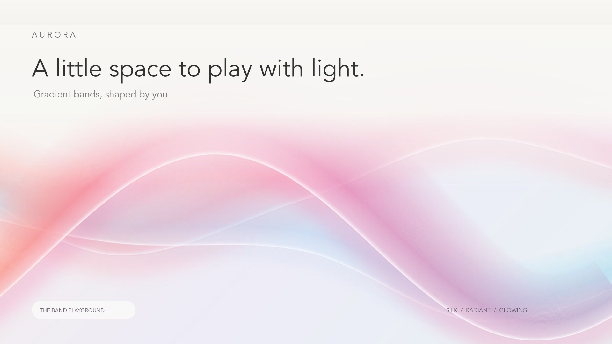

# Aurora — Band playground

Draw and animate luminous gradient bands with pen anchors, freehand strokes, or x/y coordinates. The renderer draws the artwork itself; no reference images are embedded.



[Watch the 15-second demo reel](docs/media/aurora-demo-15s.mp4) · 1080p, 30 fps

The reel uses the same band renderer with enlarged demonstration controls to show drawing, color customization, and playback. It is a prepared showcase; animation recording is not built into the editor.

## Features

- Draw naturally smoothed waves, place Bézier anchors, or enter coordinates.
- Select and move whole paths, reshape individual points, and undo edits.
- Create Silk, Radiant, and Neon bands with custom colors, glow, width, and opacity.
- Choose solid, linear-gradient, or radial-gradient backgrounds.
- Animate each band with independent speed and waviness.
- Save locally, import/export editable JSON, and export high-resolution PNGs.

## Run locally

Use **Node.js 24 LTS** and npm. From a terminal:

```sh
git clone https://github.com/joelhoke/aurora-bands.git
cd aurora-bands
npm ci
npm run dev
```

Open the local URL printed by the server (normally `http://localhost:5173`). No API keys are needed for the playground. Your artwork stays in your browser's local storage unless you export it. `npm run build` creates the production output.

The app uses React, TypeScript, Canvas 2D, and Vinext/Vite. The repository includes its Sites/Cloudflare hosting scaffold. The existing `.openai/hosting.json` identifies the original hosted project; use your own hosting configuration when deploying a fork. The hosted original has its own access settings; cloning this public repository does not require access to that site.

## Make a band

- **Pen (P):** click to place anchors; drag while placing an anchor to create a mirrored Bézier handle. Press Enter or Finish path to complete. Escape cancels the draft.
- **Draw (B):** draw a stroke and release. Natural smoothing filters hand jitter in the live preview and finished wave, preserving both endpoints. Equal-distance sampling keeps the result consistent across drawing speeds. Curves are fitted to a small set of Bézier anchors rather than fixed-distance points. Use **Smooth & simplify** to reduce anchors on an existing path; its toast shows the before/after count. Undo restores the original.
- **Coordinates:** use the code icon to create a band, or Edit path coordinates for the selected band. Enter one `x, y` pair per line. The canvas is 1200 × 800; (0, 0) is top left. Off-canvas points are allowed.
- **Move paths (V):** drag a band anywhere along its visible ribbon to move the whole path, preserving every anchor and curve handle. Undo restores the full move in one step.
- **Edit points (A):** click and drag individual anchors. Click an anchor to reveal its incoming and outgoing Bézier handles. Dragging between anchors can still move the whole path.
- **Delete:** click a band or point, then press Delete/Backspace or click the contextual trash button. A path with only two points is removed if either point is deleted. Undo restores deleted paths and points. Click empty canvas to deselect. Backspace removes the last point of an unfinished pen path.
- **Appearance:** choose Silk, Radiant, or Neon, then edit colors with the swatches or hex values. Add or reverse color stops; adjust width, glow, and opacity.
- **Canvas background:** choose Solid, Linear, or Radial. Gradients support 2–5 custom colors (picker or hex), reversing the color order, and a 0–360° direction for linear gradients. Radial colors run from the center outward. Switching back to Solid preserves your gradient settings. Backgrounds are included in autosave, project files, undo/redo, and PNG exports.
- **Motion:** each band has independent speed and waviness. Space pauses or resumes the whole canvas.
- **Layers:** rename, duplicate, hide, delete, or move the selected band forward. Undo/redo works within the current page session (Cmd/Ctrl Z and Shift Cmd/Ctrl Z).
- **Presets:** a preset replaces the canvas. Undo restores the prior scene.

The project autosaves to this browser. Export provides a 2400 × 1600 PNG of the current frame or editable JSON. Use the folder icon to import JSON. PNG is a still image; video export is not included. On narrow screens, open the sliders button to reveal properties.

## Source map

| File | Responsibility |
| --- | --- |
| `app/page.tsx` | Editor controls, pointer/keyboard input, history, autosave, import/export, responsive property panel. |
| `app/bands.ts` | Data types, presets, Bézier sampling, freehand simplification, continuous ribbon rendering, project validation. |
| `app/globals.css` | Interface colors, typography, spacing, responsive breakpoints. |
| `app/layout.tsx` | Page title, description, favicon. |
| `tests/bands.test.mjs` | Geometry, motion, parsing, and import validation checks. |
| `.openai/hosting.json` | Private Site identity and hosting configuration. |

The rendering is layered Canvas 2D. The editable path follows the brightest ridge (the edge of Silk, the center of Radiant/Neon). Continuous strips follow each curve to create a soft cross-band profile; a longitudinal gradient supplies color, with a glow pass beneath it. Tight inward bends narrow gradually to prevent offset strips folding over. Animation changes the wave displacement and color phase; guides follow the visible animated ridge. Paused scenes only repaint when edited. Imported paths and scene size are bounded to avoid excessive rendering work.

## Small tuning changes

| Location | Current value | Effect / linked changes |
| --- | --- | --- |
| `makeBand` in `app/bands.ts` | Width 150 px | Increase for wider new bands. Existing scenes and presets keep their own widths. |
| `makeBand.colors` | Pink, lavender, blue | Change the three six-digit hex values to set the palette for newly drawn bands. |
| `makeBand` motion | Speed 0.7, amplitude 20 canvas px | Higher speed moves faster; higher amplitude bends the path farther from its base. The UI labels waviness on a relative 0–100 scale. |
| `preset()` | Five layered studies and a blank canvas | Change each band's points, colors, width, or treatment. Browser autosave overrides the startup preset; choose a preset explicitly to see changes. |
| `W` / `H` | 1200 / 800 | Canvas dimensions affect coordinates, exports, aspect ratio, and labels. Changing these requires coordinated updates in `page.tsx` and CSS. |
| `--pink` in `app/globals.css` | `#b25b7c` | Primary interface accent. Companion colors are in the same file. |
| Property sliders + `validateScene` | Width 5–400; glow/opacity/waviness 0–100; speed 0–3 | These are chosen editor limits, not mathematical limits. Update the slider and import validator together. |

For example, change `makeBand` width from 150 to 220 for broader new strokes. Preset widths and already saved scenes do not change. Curve fitting uses a 4 canvas-pixel tolerance initially and increases it only if needed to respect the anchor budget. New strokes target at most 64 anchors; simple waves usually need only a handful. Incoming (`ix`, `iy`) and outgoing (`hx`, `hy`) handles are vectors relative to each anchor, so translation preserves them. Existing projects without incoming handles retain mirrored-handle behavior. Changing the file format, adding animation export, or changing curve interpolation deserves a coordinated implementation and validation pass.

## Verification

`node --test tests/bands.test.mjs` runs geometry/data and smoothing regression tests. `node node_modules/typescript/bin/tsc --noEmit` checks types. Browser QA covered pen handles, freehand creation, valid/invalid coordinates, undo/redo, hex colors, PNG export, desktop layout, and a 390 px mobile viewport without horizontal overflow. The browser console was free of errors during this pass.
